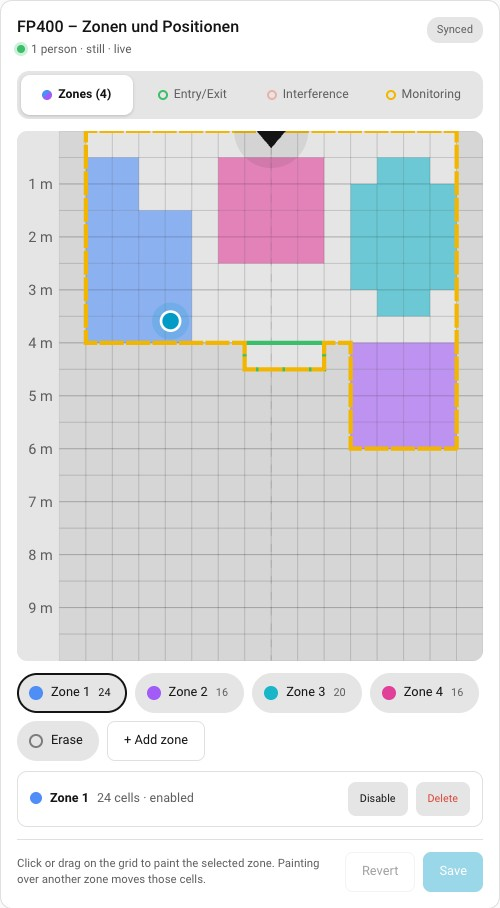
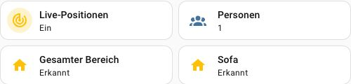

# fp400-card

**Aqara FP400: Zonenkarte und Live-Positionen in Home Assistant – mit zusätzlichem Controller und Einrichtungsdialog. Bestehende Matter-Geräte bleiben auf ihrem bisherigen Server.**

Ein experimenteller Fork von [RAR/ha-aqara-fp400](https://github.com/RAR/ha-aqara-fp400). Kein offizielles Aqara-, Home-Assistant- oder HACS-Produkt.

> **Teststand:** Auf HA OS 18.3 / Core 2026.10.2 (amd64) mit echtem FP400 1.2.0.0 zusätzlich gekoppelt. Vier Zonen, zwei Bereiche, frische Leermeldungen und Wiederverbindung nach App-Neustart geprüft. **Sitztest bestanden:** Eine tatsächlich sitzende Person wird mit Live-Position, Zustand „still“ und passender Sofa-Belegung erkannt. Alle 16 vorhandenen Matter-Geräteregister-IDs und 23 Radar-Entitäts-IDs blieben erhalten. **Der gezielte Gangtest bleibt offen.** ARM64 und eine reale Anlage mit 32 Geräten wurden nicht getestet. [Vollständiger Prüfstand](PRUEFSTAND.md).

## Vorschau

### Echte Radar-Karte



*Aufnahme aus dem echten HA-Betrieb mit FP400: eine Person, Zustand „still“, Live-Tracking eingeschaltet. Keine simulierten Personenpositionen.*

### Echte Personenerkennung und Sofa-Belegung



*Der Sitztest ist bestanden. Die Bilder belegen keine kontrollierte Gehstrecke; dieser Test steht weiterhin aus. Die Ausschnitte enthalten keine HA-Adresse, Zugangsdaten oder persönlichen Profilangaben.*

## Was das Projekt macht

Die Integration liefert eine interaktive Zonenkarte, Radar-Sensoren und Einstellungen. Für die herstellerspezifischen Zusatzfunktionen läuft eine eigene HA-App **FP400 Einrichtung** mit einem lokalen Matter-Controller. Ausschließlich der bereits in HA vorhandene FP400 wird zusätzlich verbunden. Er wird anhand von Seriennummer, Hersteller und Produkt seinem bestehenden HA-Gerät zugeordnet.

Der bisherige Matter-Server wird nicht ersetzt oder umkonfiguriert. Die zusätzliche App hat eigene gespeicherte Kopplungsdaten; es werden keine bisherigen Geräte oder Fabrics entfernt. Der Controller muss für die Zusatzfunktionen weiterlaufen.

## Voraussetzungen

- Home Assistant OS, Core 2026.9+, 64 Bit (amd64 oder ARM64; letzteres noch ohne Hardwaretest).
- FP400 direkt über die bestehende HA-Matter-Integration vorhanden und erreichbar.
- HA und FP400 können sich lokal erreichen. Der Browser darf aus der Ferne über Nabu Casa zugreifen; die Erkennung läuft auf HA zu Hause.
- Vollständige abgeschlossene Sicherung einschließlich bestehendem Matter-Server; bei externem Server dessen Daten separat sichern.

## Empfohlene Installation über den HA-App-Store

Für den kompletten Einrichtungsdialog ist HACS nicht erforderlich:

### Schritt 1: Bestehendes HA sichern

Öffne **Einstellungen → System → Backups** und erstelle eine vollständige Sicherung einschließlich deines bisherigen Matter-Servers. Warte auf den Abschluss. Läuft der Server außerhalb von HA, sichere seine Daten zusätzlich dort. Prüfe, dass dein FP400 schon in HA über Matter erreichbar ist.

### Schritt 2: App-Quelle hinzufügen und installieren

1. **Einstellungen → Apps → App-Store → Menü → Repositorys** öffnen.
2. `https://github.com/ckundel2008/fp400-card` hinzufügen und die Store-Seite neu laden.
3. Unter **FP400 Card & Controller** die App **FP400 Einrichtung** installieren. Der lokale Build kann mehrere Minuten dauern.

### Schritt 3: Einrichtungsdialog öffnen

Aktiviere **Beim Systemstart starten**, starte die App und wähle **Benutzeroberfläche öffnen**. Lass den Schutzmodus eingeschaltet. Bestätige im Dialog deine abgeschlossene Sicherung.

### Schritt 4: FP400-Integration vorbereiten

Klicke im Dialog **FP400-Integration installieren**. Eine vorhandene FP400-Integration wird vorher gesichert. Starte danach **Home Assistant einmal neu** und öffne den Assistenten wieder. Der bestehende Matter-Server bleibt eingerichtet.

### Schritt 5: Nur den FP400 zusätzlich verbinden

1. Öffne **Einstellungen → Geräte & Dienste → Matter → deinen FP400**.
2. Wähle **Gerät teilen** beziehungsweise **Mit anderem Ökosystem verbinden**.
3. Kopiere den frisch erzeugten Freigabecode in den Assistenten und bestätige, dass er zu deinem FP400 gehört.
4. Klicke **FP400 zusätzlich verbinden** und warte auf die Bestätigung.

**Keinen Code vom Aufkleber verwenden, keinen Werksreset durchführen, keine bestehenden Geräte entfernen und den bisherigen Matter-Server nicht umstellen.**

### Schritt 6: Integration in HA aktivieren

Öffne **Einstellungen → Geräte & Dienste → Integration hinzufügen**, suche **Aqara FP400 (Zusatzcontroller)** und bestätige den Dialog. Eine Serveradresse musst du nicht eingeben.

**Bereits ein FP400-Integrationseintrag vorhanden?** Öffne dessen **Konfigurieren**-Dialog, aktiviere **Zusätzlichen FP400-Controller verwenden (empfohlen)** und speichere. Keinen zweiten Eintrag anlegen und das bestehende Matter-Gerät behalten.

### Schritt 7: Karte und Live-Positionen prüfen

Öffne das Radar-Gerät und schalte **Live-Positionen** ein. Füge die Karte wie unter [Karte anzeigen](#karte-anzeigen) beschrieben hinzu. Bewege dich vor dem Sensor: Die Personenanzahl und Positionen sollen sich verändern. Bei Fernzugriff muss dafür jemand zu Hause sein.

Prüfe anschließend einige deiner bisherigen Matter-Geräte und eine bestehende Automation. Sichere den fertigen Zustand **einschließlich FP400 Einrichtung**. Die App bleibt für die Zusatzfunktionen eingeschaltet.

Wenn HA beim Hinzufügen der Repository-Adresse einen Fehler wie `required key not provided ... repository` meldet, den ZIP-Weg unten verwenden. Diese Meldung trat im getesteten HA-Dialog auf; über die Supervisor-Schnittstelle wurde dieselbe Quelle akzeptiert und die App korrekt im Katalog erkannt. Dafür müssen keine bestehenden Matter-Einstellungen geändert werden.

**Schon die lokale App aus dem ZIP installiert?** Diese weiterverwenden. Die Repository-App hat einen anderen internen Namen und eigene Kopplungsdaten. Nicht beide gleichzeitig starten (Port 5581), die lokale App nicht einfach deinstallieren. Eine Migration der gespeicherten Controllerdaten ist hier nicht automatisiert.

## Optional: Integration mit HACS verwalten

Das Repository ist für **HACS → Benutzerdefinierte Repositories → Typ Integration** aufgebaut. Die Karte wird mit dieser Integration geliefert; nicht zusätzlich als Dashboard-Repository eintragen. Die Controller-App wird weiterhin über den HA-App-Store installiert: HACS installiert keine HA-Apps.

1. HACS öffnen, oben im Menü **Benutzerdefinierte Repositories** wählen.
2. `https://github.com/ckundel2008/fp400-card` eintragen, Typ **Integration** auswählen und hinzufügen.
3. **FP400 Card & Controller** herunterladen. Danach HA neu starten.
4. Controller-App wie oben einrichten; danach den vorhandenen FP400-Eintrag konfigurieren bzw. den Erstinstallationsdialog abschließen.

**Wechsel vom Original RAR:** Beide Projekte verwenden bewusst die Domain `aqara_fp400`, damit Geräte- und Entitäts-IDs erhalten bleiben. Sie dürfen denselben Ordner nicht parallel aktualisieren. Zuerst HA sichern und diese Fork-Quelle in HACS hinzufügen. Den ursprünglichen Download in HACS deinstallieren, unmittelbar anschließend diese Fork herunterladen und erst danach HA neu starten. **Den bestehenden Eintrag unter Geräte & Dienste und das Matter-Gerät nicht löschen.** Kann HACS die neue Quelle nicht anbieten, den bisherigen Stand beibehalten und die Paketinstallation verwenden. Automatische Updates des Originalprojekts dürfen die Fork nicht überschreiben.

Die Aufnahme in den allgemeinen HACS-Katalog wurde mit [Antrag #12425](https://github.com/hacs/default/pull/12425) eingereicht. Sie ist noch nicht angenommen; bis dahin erfolgt die Installation als benutzerdefinierte Quelle. [Offizielle Anforderungen](https://www.hacs.xyz/docs/publish/integration/), [benutzerdefinierte Quellen](https://www.hacs.xyz/docs/faq/custom_repositories/).

**Zusätzlich geprüft:** Das echte HA akzeptiert die Quelle als benutzerdefinierte HACS-Integration und erkennt die Controller-App im App-Katalog. GitHub Actions hat Paketbau, 36 Tests und die offizielle HACS-Strukturprüfung erfolgreich ausgeführt. Das Hinzufügen wurde geprüft; eine HACS-Neuinstallation auf einem leeren HA nicht. Bei der experimentellen Vorabversion gegebenenfalls die Anzeige von Vorabversionen einschalten oder beim Download den Standardzweig wählen.

## Karte anzeigen

Dashboard bearbeiten → Karte hinzufügen → Manuell:

```yaml
type: custom:aqara-fp400-zone-card
entity: sensor.DEINE_FP400_RADAR_ZONES
title: FP400
sensor_at: top
```

Den Platzhalter durch die Zonen-Entität des eigenen Radar-Geräts ersetzen. Die Integration registriert die Kartenressource automatisch. Bei „Custom element doesn't exist“ den Browser vollständig neu laden. Nach einem vollständigen HA-Neustart den Schalter **Live-Positionen** prüfen und bei Bedarf einschalten.

## ZIP für die manuelle Installation

[Startpaket herunterladen](https://github.com/ckundel2008/fp400-card/releases/download/v1.1.3/FP400-Startpaket.zip) · [Schritt-für-Schritt-Anleitung](ANLEITUNG.md) · [Alle Downloads der Vorabversion](https://github.com/ckundel2008/fp400-card/releases/tag/v1.1.3)

Dieser alternative Ablauf nutzt File editor und Terminal & SSH, prüft die ZIP-Prüfsumme und legt eine lokale App an. Das ist dieselbe Controller-Lösung, aber ein anderer Installationsweg. Für eine neue Installation nur einen der beiden App-Wege wählen.

## Fehler und Rückweg

- **Kein FP400 gefunden:** frisches Freigabefenster öffnen, Netzwerk/IPv6 prüfen. Bei mehreren Netzwerkkarten kann in der App-Konfiguration `network_interface` gesetzt werden; normalerweise leer lassen.
- **Port 5581 belegt:** bestehenden Zusatzcontroller identifizieren. Den normalen Matter-Server nicht verändern.
- **Kopplung unklar:** eine Minute warten; anschließend nur diese App stoppen/starten. Gespeicherten, aber vorübergehend nicht erreichbaren FP400 nicht erneut anlernen.
- **Keine bewegten Punkte:** Live-Positionen einschalten und tatsächlich vor dem Sensor bewegen. Null Personen allein ist kein Bewegungstest.
- **Abschalten:** zuerst FP400-Zusatzintegration deaktivieren, danach nur diese App stoppen. Keine Fabrics löschen. Private App-Daten und vollständiges HA-Backup aufbewahren.

Die Weboberfläche läuft ausschließlich hinter HA-Ingress. Der Matter-WebSocket ist an `127.0.0.1:5581` gebunden. Die App benötigt Host-Netzwerk und einen beschreibbaren HA-Konfigurationsordner für Integration/Sicherungen, aber keine HA-Steuerungs-API und keinen Docker-Socket. [Berechtigungen und Details](fp400_setup/DOCS.md).

## Entwicklung und Herkunft

`custom_components/aqara_fp400` ist die maßgebliche Integration. `fp400_setup/integration` ist die identische erzeugte Kopie für den isolierten App-Build. `python3.13 tools/build_package.py` synchronisiert sie und baut das ZIP; die Tests prüfen die Gleichheit. Node 22+ und Python 3.13 erforderlich.

```sh
python3.13 tools/build_package.py
node --test tests/addon.test.mjs tests/package.test.mjs tests/file-preview.test.mjs tests/repository.test.mjs
python3.13 tests/test_config_flow.py
python3.13 -m compileall -q custom_components
```

MIT-Lizenz; ursprüngliche Integration und Karte © 2026 Andrew Rankin. OHF Matter Server 1.5.2 unter Apache-2.0, festgelegtes Basis-Image. Änderungen: separater Controller, sichere Zuordnung/Wiederverbindung, Installer und Dialog. [Lizenz](LICENSE) · [Drittanbieter](THIRD-PARTY.md). Bei Fehlerberichten keine Freigabecodes, Tokens oder Matter-Schlüssel veröffentlichen.
